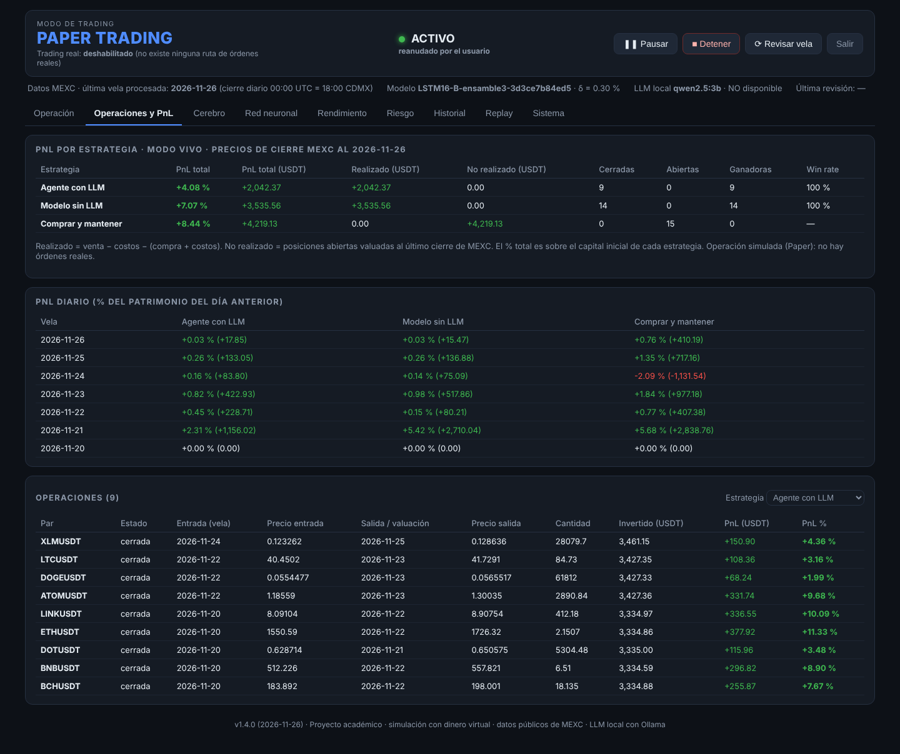
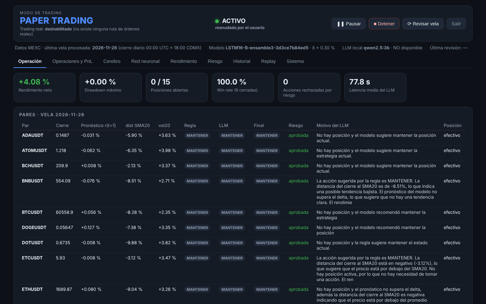
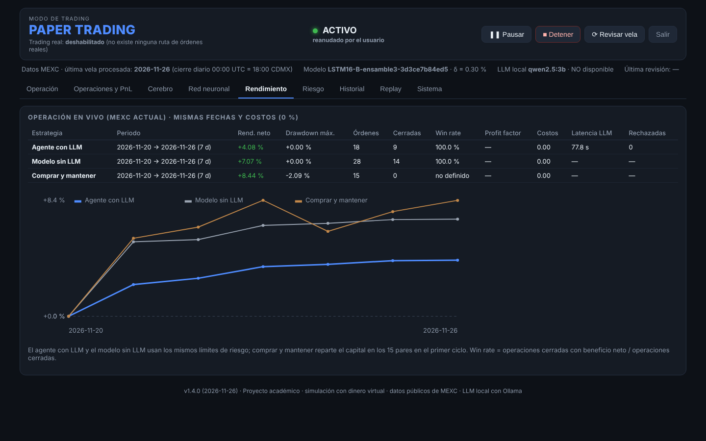
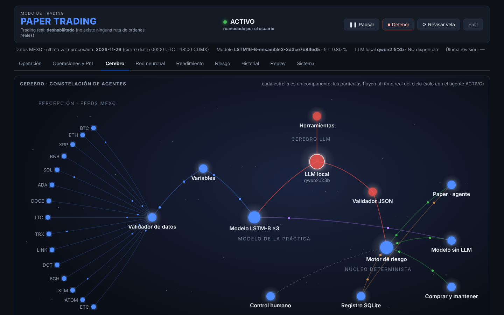
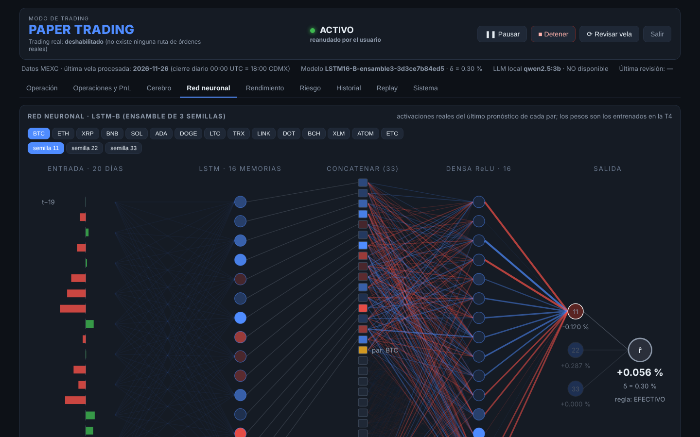
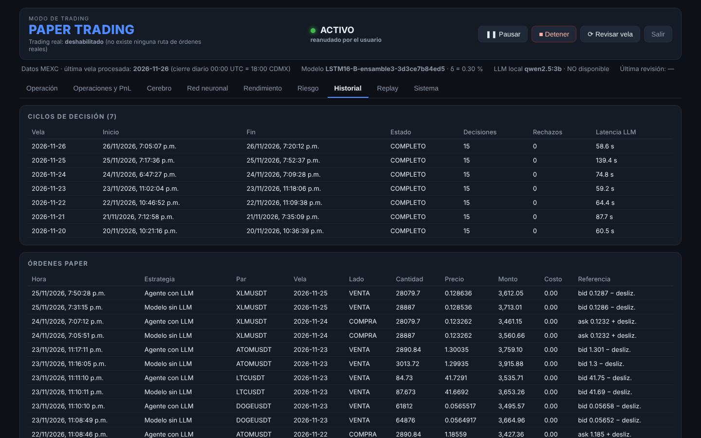
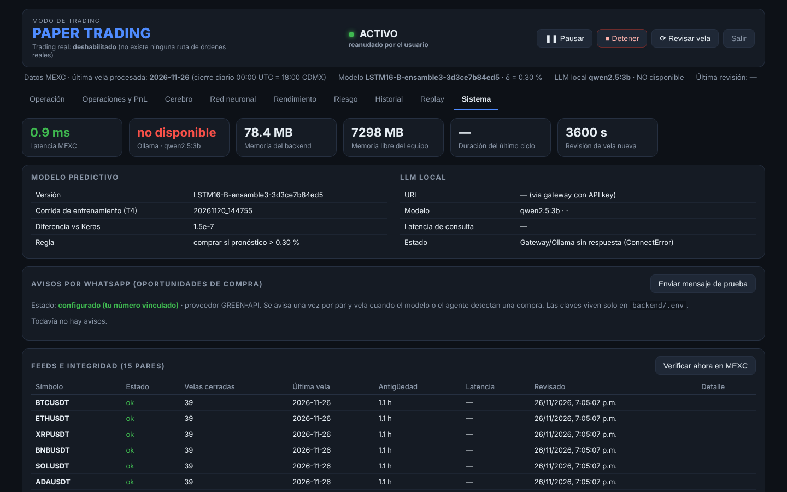
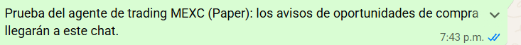

# Agente de trading MEXC (Paper) — proyecto final DL para Finanzas

**Versión actual: v1.5.0 (2026-11-27)** · Paper trading con datos reales de MEXC · 15 pares · LSTM entrenada en T4 · LLM local (Ollama) · avisos por WhatsApp

**Interfaz pública (Streamlit):** <https://agente-trading-mexc.streamlit.app>

Agente que, una vez al día, toma las velas **reales** de la API pública de MEXC para 15 pares, calcula el pronóstico de un modelo LSTM entrenado en una GPU T4, pide a un LLM local (Ollama) una propuesta, la pasa por controles de riesgo deterministas, la ejecuta en un simulador **Paper** y registra todo: operaciones, PnL, decisiones y eventos. Cuando detecta una oportunidad de compra manda un WhatsApp. **No envía órdenes reales**: no existe código firmado ni rutas de órdenes, y `TRADING_REAL=1` impide que arranque.



## Contenido

1. [Cumplimiento de la entrega](#cumplimiento-de-la-entrega)
2. [Resultados con datos reales de MEXC](#resultados-con-datos-reales-de-mexc)
3. [Versiones y avances](#versiones-y-avances)
4. [Arquitectura](#arquitectura)
5. [Ciclo del agente](#ciclo-del-agente)
6. [Modelo predictivo (capítulos 7 a 11)](#modelo-predictivo-capítulos-7-a-11)
7. [Interfaz](#interfaz) y [vista pública en Streamlit](#vista-pública-en-streamlit)
8. [Operaciones y PnL](#operaciones-y-pnl)
9. [Avisos por WhatsApp](#avisos-por-whatsapp)
10. [Instalación y operación diaria](#instalación-y-operación-diaria)
11. [Controles de riesgo](#controles-de-riesgo)
12. [Seguridad](#seguridad)
13. [Los 9 errores del protocolo](#los-9-errores-del-protocolo)
14. [API del backend](#api-del-backend)
15. [Pruebas](#pruebas)
16. [Estructura del repositorio](#estructura-del-repositorio)
17. [Limitaciones y trabajo futuro](#limitaciones-y-trabajo-futuro)

## Cumplimiento de la entrega

| # | Requisito | Dónde está |
| --- | --- | --- |
| 1 | Presentación ejecutiva del sistema | Se entrega aparte; resume la información de este README |
| — | Link de la interfaz (Streamlit) | [Vista pública en Streamlit](#vista-pública-en-streamlit): señales del día con datos de MEXC en vivo, operaciones y PnL, rendimiento y decisiones del agente |
| 2 | Git con el código del sistema | Este repositorio: backend FastAPI, interfaz React + TypeScript, modelo, pruebas y scripts |
| 3 | README completo, con versiones y avances | Este archivo; ver [Versiones y avances](#versiones-y-avances) |
| 4 | Datos reales de Polymarket o MEXC | API pública v3 de MEXC: velas diarias cerradas (`/api/v3/klines`), libro (`/api/v3/ticker/bookTicker`) y reglas del par (`/api/v3/exchangeInfo`). Operación en vivo desde la vela del 2026-11-20 |
| 5 | Operaciones y PnL | Pestaña **Operaciones y PnL**: cada operación (entrada, salida, cantidad, invertido, PnL en USDT y %), PnL realizado y no realizado por estrategia y PnL diario. API: `GET /api/pnl` |

## Resultados con datos reales de MEXC

Operación en vivo con las velas diarias del **2026-11-20 al 2026-11-26** (7 ciclos completos, 105 decisiones). Capital simulado de 50,000 USDT por estrategia, costo de 0 % (comisión spot de MEXC) y deslizamiento de 0.05 %:

| Estrategia | PnL total | PnL (USDT) | Realizado | No realizado | Operaciones cerradas | Ganadoras | Drawdown máx. |
| --- | --- | --- | --- | --- | --- | --- | --- |
| Agente con LLM | **+4.08 %** | +2,042.37 | +2,042.37 | 0.00 | 9 | 9 (100 %) | 0.00 % |
| Modelo sin LLM (regla δ = 0.30 %) | **+7.07 %** | +3,535.56 | +3,535.56 | 0.00 | 14 | 14 (100 %) | 0.00 % |
| Comprar y mantener (1/15 por par) | **+8.44 %** | +4,219.13 | 0.00 | +4,219.13 | 0 (15 abiertas) | — | −2.09 % |

Lectura de los resultados:

- Las tres estrategias ganaron en una semana alcista. Comprar y mantener ganó más, pero tuvo el único día con pérdida (−2.09 % el 2026-11-24); el agente y el modelo no tuvieron días negativos.
- El agente ganó menos que el modelo porque en las velas del 20 y 21 de noviembre el LLM no siguió 10 compras de la regla. Se corrigió en la v1.2.1 (contexto solo en por ciento, la regla como acción por defecto y temperatura 0); desde la vela del 22 el LLM sigue la regla y no ha habido desvíos.
- Siete días y 9 operaciones no son evidencia estadística. En el periodo de prueba del notebook (TE, casi un año) la regla perdió −9.86 % contra −40.50 % de comprar y mantener.

**Replay** de las velas del 2026-11-01 al 2026-11-20 (mismo ciclo con LLM, ejecución en la apertura del día siguiente, guardado aparte de la operación en vivo): agente +0.67 % y modelo +0.67 % (27 operaciones cerradas, win rate 66.7 %, drawdown −3.63 %) contra **−23.88 %** de comprar y mantener (drawdown −25.75 %). En la caída, la regla protegió el capital.

Operaciones cerradas del agente con LLM en vivo (precios de ejecución de MEXC con deslizamiento):

| Par | Entrada (vela) | Precio entrada | Salida (vela) | Precio salida | PnL (USDT) | PnL % |
| --- | --- | --- | --- | --- | --- | --- |
| ETHUSDT | 2026-11-20 | 1,550.59 | 2026-11-22 | 1,726.32 | +377.92 | +11.33 % |
| LINKUSDT | 2026-11-20 | 8.09104 | 2026-11-22 | 8.90754 | +336.55 | +10.09 % |
| ATOMUSDT | 2026-11-22 | 1.18559 | 2026-11-23 | 1.30035 | +331.74 | +9.68 % |
| BNBUSDT | 2026-11-20 | 512.226 | 2026-11-22 | 557.821 | +296.82 | +8.90 % |
| BCHUSDT | 2026-11-20 | 183.892 | 2026-11-22 | 198.001 | +255.87 | +7.67 % |
| XLMUSDT | 2026-11-24 | 0.123262 | 2026-11-25 | 0.128636 | +150.90 | +4.36 % |
| DOTUSDT | 2026-11-20 | 0.628714 | 2026-11-21 | 0.650575 | +115.96 | +3.48 % |
| LTCUSDT | 2026-11-22 | 40.4502 | 2026-11-23 | 41.7291 | +108.36 | +3.16 % |
| DOGEUSDT | 2026-11-22 | 0.0554477 | 2026-11-23 | 0.0565517 | +68.24 | +1.99 % |

Otros datos de la operación en vivo: 0 propuestas rechazadas por riesgo, 0 JSON inválidos y latencia media del LLM de 77.8 s por consulta (CPU, 8 GB de RAM). La bitácora registró 4 caídas de conexión con MEXC y 2 de Ollama; en todas el agente pasó a PAUSADO_ERROR, no operó y se reanudó sin duplicar órdenes.

## Versiones y avances

### App del agente

| Versión | Fecha | Cambios |
| --- | --- | --- |
| **v1.5.0** | 2026-11-27 | **Vista pública en Streamlit** con link: señales del día con las velas de MEXC en vivo y el mismo LSTM, operaciones y PnL, rendimiento, decisiones con la justificación del LLM y el modelo. `backend/exportar_snapshot.py` publica el registro del agente |
| v1.4.0 | 2026-11-26 | Pestaña **Operaciones y PnL** (PnL realizado, no realizado y diario por estrategia; cada operación con entrada, salida y PnL en USDT y %). PnL también en el Replay. `GET /api/pnl`. Versión visible en la interfaz y en `/api/estado`. README completo con resultados reales y capturas |
| v1.3.1 | 2026-11-26 | Avisos por WhatsApp con **GREEN-API** (vinculas tu WhatsApp con un QR); CallMeBot queda como alternativa porque su bot no tenía cupo |
| v1.3.0 | 2026-11-26 | **Avisos por WhatsApp** de oportunidades de compra (una vez por par y vela, solo en vivo; un fallo no afecta al trading). A petición del profesor se quitó de la interfaz el saldo (tarjetas de patrimonio y efectivo) y la gráfica pasó a rendimiento en % |
| v1.2.1 | 2026-11-21 | LLM: contexto solo en por ciento, la regla como acción por defecto (un desvío debe empezar con `Desvío:`) y temperatura 0 |
| v1.2.0 | 2026-11-20 | LLM: pronóstico y δ en por ciento y campo `pronostico_supera_delta`, para que el LLM no confunda unidades |
| v1.1.1 | 2026-11-20 | Riesgo: las compras del mismo ciclo cuentan a su costo, para que comprar y mantener reparta exactamente 1/15 por par |
| v1.1.0 | 2026-11-20 | Pestañas **Cerebro** (constelación de componentes con su estado) y **Red neuronal** (activaciones reales de la LSTM); feeds e integridad por par |
| v1.0.2 | 2026-11-20 | Instalador: detecta el Python real (no el alias de la Microsoft Store) y guarda los scripts con BOM (acentos correctos) |
| v1.0.1 | 2026-11-20 | Scripts: instalar y abrir la interfaz antes de tener Ollama |
| v1.0.0 | 2026-11-20 | Primera versión: backend FastAPI, ciclo diario con MEXC, LSTM en NumPy, LLM local con herramientas de solo lectura, motor de riesgo, motor Paper con tres estrategias, SQLite, interfaz React + TypeScript, Replay y pruebas de los 9 errores |

### Notebooks del modelo

| Versión | Avance |
| --- | --- |
| Capítulos 7 a 10 (v1.0) | Datos, partición, modelos de referencia, MLP/LSTM, validación temporal y entorno del agente |
| Capítulos 10 y 11 (v1.1) | Correcciones del capítulo 11 (variable `VA` y zona horaria) |
| `BD2_MEXC15_Cap7a11_v2.0` | Los 15 pares de MEXC con un solo modelo, entrenado en T4 |
| `BD2_MEXC15_Cap7a11_v2.1` | Corrige la paginación de la descarga (`endTime` exclusivo omitía velas). Corrida final `20261120_144755`, exportada a `backend/modelo/` |

### Bitácora de la operación en vivo

| Vela | Compras de la regla | Qué pasó |
| --- | --- | --- |
| 2026-11-20 | 12 | Primer ciclo en vivo; comprar y mantener abre los 15 pares; el LLM no sigue 8 compras de la regla |
| 2026-11-21 | 3 | El LLM vuelve a desviarse; se publica la v1.2.1 |
| 2026-11-22 | 3 | El LLM sigue la regla; se cierran ETH, LINK, BNB y BCH con ganancia |
| 2026-11-23 | 0 | Se cierran ATOM, LTC y DOGE con ganancia |
| 2026-11-24 | 1 | Compra de XLM; comprar y mantener cae −2.09 % |
| 2026-11-25 | 0 | Venta de XLM (+4.36 %) |
| 2026-11-26 | 0 | Sin señales; se activan los avisos por WhatsApp (v1.3) y Operaciones y PnL (v1.4) |

## Arquitectura

```
React + TypeScript ──(cookie de sesión)──▶ Backend FastAPI :8000 ──▶ Modelo LSTM (NumPy, pesos de la T4)
                                             │      │
                                             │      └──(X-API-Key)──▶ Gateway :8001 ──▶ Ollama local :11434 (qwen2.5:3b)
                                             ├──▶ Motor de riesgo determinista ──▶ Motor Paper ──▶ SQLite (registro)
                                             ├──▶ API pública de MEXC (velas cerradas, libro, exchangeInfo)
                                             └──▶ Avisos por WhatsApp (GREEN-API o CallMeBot)
```

| Componente | Tecnología | Archivos |
| --- | --- | --- |
| Interfaz | React 18, TypeScript 5.6, Vite 5 | `frontend/src/` |
| Backend y ciclo | Python 3.11+, FastAPI, httpx | `backend/app/main.py`, `ciclo.py` |
| Datos | API pública de MEXC v3 | `backend/app/mexc.py`, `variables.py` |
| Modelo | Ensamble de 3 LSTM-16 en NumPy | `backend/app/modelo.py`, `backend/modelo/` |
| LLM | Ollama `qwen2.5:3b` detrás de un gateway con API key | `backend/app/llm.py`, `backend/gateway.py` |
| Riesgo y Paper | Reglas deterministas y libro simulado | `backend/app/riesgo.py`, `paper.py` |
| Métricas y PnL | Rendimiento, drawdown, win rate, PnL | `backend/app/metricas.py` |
| Avisos | WhatsApp | `backend/app/notificador.py` |
| Registro | SQLite (WAL) | `backend/app/db.py` |

## Ciclo del agente

La vela diaria de MEXC cierra a las 00:00 UTC (18:00 en Ciudad de México). El backend revisa cada 60 s si cerró una vela nueva; **no acelera la frecuencia del modelo**.

1. Consulta las velas **cerradas** de los 15 pares y valida activo, frecuencia diaria, orden, continuidad y antigüedad (≤ 26 h).
2. Calcula las variables con la **misma definición del entrenamiento** (20 rendimientos, `dist_sma20`, `vol20`) y obtiene el pronóstico del ensamble LSTM-B (3 semillas).
3. Consulta a Ollama con datos estructurados y dos herramientas de **solo lectura** (`consultar_posicion`, `consultar_historial`).
4. Exige JSON `{accion, simbolo, fecha_vela, justificacion}`; valida tipos y valores; rechaza símbolos o acciones no permitidos.
5. Aplica el motor de riesgo (el LLM no puede saltárselo ni cambiar sus límites).
6. Ejecuta en Paper (compra al ask y vende al bid del libro de MEXC, con deslizamiento) y actualiza posiciones y patrimonio. La misma vela nunca se procesa dos veces.
7. Si hay una oportunidad de compra, manda el aviso por WhatsApp.
8. Muestra el resultado en la interfaz y espera la siguiente vela o la intervención del usuario.

En paralelo se llevan tres libros Paper con el mismo periodo y costos: **agente con LLM**, **modelo sin LLM** (regla de la práctica: comprar si el pronóstico > 0.30 %) y **comprar y mantener**.

Pares: BTC, ETH, XRP, BNB, SOL, ADA, DOGE, LTC, TRX, LINK, DOT, BCH, XLM, ATOM y ETC contra USDT.

## Modelo predictivo (capítulos 7 a 11)

Un solo modelo para los 15 pares (panel; el par entra como variable indicadora). Objetivo: rendimiento del día siguiente con los 20 rendimientos conocidos al cierre de t, más `dist_sma20` y `vol20`.

| Elemento | Valor |
| --- | --- |
| Datos | Velas diarias UTC de MEXC del 2020-09-01 al 2026-11-19 (2,271 por par, sin faltantes) |
| Partición por fecha del objetivo | TR 70 % (23,625 ejemplos) · VA 15 % (5,070) · TE 15 % (5,055) |
| Arquitectura | LSTM de 16 neuronas + par one-hot → Dense(16, ReLU) → Dropout(0.10) → Dense(1); ensamble de 3 semillas (11, 22 y 33) |
| Entrenamiento | Google Colab, NVIDIA Tesla T4, TensorFlow 2.21, corrida `20261120_144755` |
| Selección | Modelo con menor RMSE en VA; regla con mayor rendimiento neto en VA (δ = 0.30 %, sin filtro SMA20) |

Resultados en TE (2025-12-18 a 2026-11-19), con la configuración congelada antes de abrir TE:

| Modelo | RMSE TE (pp) | MAE TE (pp) | Precisión direccional |
| --- | --- | --- | --- |
| Pronóstico cero | 3.3191 | 2.2157 | no definida |
| **LSTM 16 + indicadores** | **3.3131** | 2.2214 | 48.37 % |
| MLP 16 + indicadores | 3.3518 | 2.2543 | 47.82 % |
| Regresión lineal + indicadores | 3.3719 | 2.2671 | 48.61 % |

| Simulación en TE | Rendimiento neto | Drawdown máx. |
| --- | --- | --- |
| Regla congelada, costo 0.10 % | −9.86 % | −19.18 % |
| Regla congelada, costo 0 % (MEXC) | −7.36 % | −18.30 % |
| Comprar y mantener | −40.50 % | −48.53 % |

La LSTM reduce poco el error frente al pronóstico cero y la regla no gana fuera de muestra, pero deja el drawdown en menos de la mitad del de comprar y mantener. TE se consultó una vez antes de la corrida final (versión v2.0, con un error de descarga); está declarado en el informe.

Archivos en `backend/modelo/`: `lstm16_B_pesos.npz` (pesos y salidas de referencia de Keras), `escaladores.json` (ajustados solo con TR), `contrato_variables.json` (orden de pares, variables y regla) y `config_congelada.json` (con huella SHA-256). La inferencia se hace con NumPy para no instalar TensorFlow (la computadora tiene 8 GB de RAM). Al arrancar se verifica contra Keras (diferencia máxima 1.5 × 10⁻⁷), y una prueba confirma que con precios reales de MEXC da los mismos pronósticos que el notebook (BTC +0.2502 %, LTC +0.6067 %, XRP −0.1158 % para la vela del 2026-11-19).

## Interfaz

| Pestaña | Qué muestra |
| --- | --- |
| **Operación** | Rendimiento, drawdown, posiciones abiertas, win rate y, por par: cierre, pronóstico, `dist_sma20`, `vol20`, acción de la regla, del LLM y final, revisión de riesgo, motivo y posición |
| **Operaciones y PnL** | PnL por estrategia, PnL diario y cada operación con su PnL |
| **Cerebro** | Constelación animada de los componentes con su estado (feeds, validador, variables, LSTM, LLM, herramientas, validador JSON, riesgo, Paper y registro) |
| **Red neuronal** | La LSTM capa por capa con las activaciones reales del último pronóstico de cada par y los pesos entrenados |
| **Rendimiento** | Rendimiento acumulado en % de las tres estrategias, drawdown, órdenes, win rate y latencia del LLM |
| **Riesgo** | Límites vigentes, exposición y edición protegida |
| **Historial** | Ciclos, órdenes Paper y todas las decisiones (incluye rechazos) |
| **Replay** | Repetición histórica separada de la operación en vivo, con su propio rendimiento y PnL |
| **Sistema** | Latencias, memoria, estado del modelo y del LLM, avisos por WhatsApp, feeds e integridad de los 15 pares y bitácora |

Capturas con la base de datos real de la operación en vivo (abierta en una copia, sin Ollama corriendo):

| | |
| --- | --- |
|  |  |
|  |  |
|  |  |

## Vista pública en Streamlit

La interfaz completa (React) corre en la computadora del equipo, junto al LLM local. Para tener un **link público** hay una vista de solo lectura en Streamlit Community Cloud: `streamlit_app.py`.

| Pestaña | Qué muestra |
| --- | --- |
| Señales de hoy | Descarga en ese momento las velas diarias cerradas de los 15 pares desde la API pública de MEXC y calcula el pronóstico con el **mismo** LSTM del agente y la regla δ = 0.30 % |
| Operaciones y PnL | PnL por estrategia, cada operación y el PnL diario (en vivo y Replay) |
| Rendimiento | Rendimiento acumulado en % de las tres estrategias, drawdown y win rate |
| Decisiones del agente | Cada decisión en vivo: regla, LLM, decisión final, revisión de riesgo y justificación del LLM |
| Modelo y Cómo funciona | Datos, arquitectura, métricas en TE y el ciclo del agente |

Las operaciones, el PnL y las decisiones salen de `datos_publicos/snapshot_agente.json`, exportado de la base real del agente. No contiene claves. Para actualizarlo:

```powershell
.venv\Scripts\python backend\exportar_snapshot.py
```

y sube `datos_publicos/snapshot_agente.json` a GitHub: Streamlit vuelve a desplegar solo. La página no envía órdenes, no usa claves y no ejecuta el LLM.

Despliegue (una sola vez): en <https://share.streamlit.io> entra con GitHub → **Create app** → repositorio `alan2018fc-spec/agente-trading-mexc`, rama `main`, archivo `streamlit_app.py` → **Deploy**. Usa `requirements.txt` de la raíz (streamlit, numpy, pandas, requests).

Para probarla en tu computadora: `.venv\Scripts\pip install streamlit pandas requests` y `.venv\Scripts\streamlit run streamlit_app.py`.

## Operaciones y PnL

Una **operación** es una compra Paper y su venta posterior del mismo par en la misma estrategia. Para cada una se muestra la vela y el precio de entrada, la vela y el precio de salida (o de valuación si sigue abierta), la cantidad, lo invertido y el PnL.

- **PnL realizado** = (venta − costo de venta) − (compra + costo de compra).
- **PnL no realizado** = posiciones abiertas valuadas al último cierre de MEXC − (compra + costo de compra).
- **PnL total** = realizado + no realizado; su % es sobre el capital inicial de la estrategia. Una prueba automática verifica que coincide con el patrimonio final de cada estrategia.
- **PnL diario** = cambio del patrimonio contra el cierre del día anterior.

En vivo, las compras se hacen al ask y las ventas al bid de `bookTicker` de MEXC, con deslizamiento de 0.05 %. Las cantidades se redondean con `baseSizePrecision` de `exchangeInfo`.

## Avisos por WhatsApp

Cuando el modelo o el agente detectan una **oportunidad de compra** (pronóstico > 0.30 % o compra aprobada), el backend manda un WhatsApp con el par, la vela, el pronóstico, el precio de cierre, qué hizo el agente y su motivo. Se avisa **una sola vez por par y vela**, solo en la operación en vivo (no en el Replay). Si el aviso falla, se registra en la bitácora y el trading sigue igual. El panel **Sistema → Avisos por WhatsApp** muestra el estado, un botón de mensaje de prueba y el historial de avisos.



Proveedores gratuitos (se elige con `WHATSAPP_PROVEEDOR` en `backend\.env`):

**GREEN-API (recomendado).** Plan Developer gratis; vinculas tu propio WhatsApp como en WhatsApp Web y el agente te escribe a tu propio chat.

1. Crea una cuenta en `console.green-api.com` y crea una instancia con el plan **Developer** (gratis).
2. En la instancia, escanea el QR desde tu celular: WhatsApp → Dispositivos vinculados → Vincular un dispositivo.
3. Copia `apiUrl`, `idInstance` y `apiTokenInstance` a `backend\.env` como `GREENAPI_URL`, `GREENAPI_ID_INSTANCE` y `GREENAPI_TOKEN` (deja `WHATSAPP_PROVEEDOR=greenapi`). `WHATSAPP_TELEFONO` puede quedar vacío: se usa tu número vinculado.
4. Reinicia `iniciar.ps1` y en **Sistema → Avisos por WhatsApp** pulsa **Enviar mensaje de prueba**. Te llega en el chat contigo mismo.

Es una API no oficial (funciona como un dispositivo vinculado); como solo te escribes a ti mismo, el riesgo es bajo. Puedes desvincularla cuando quieras desde WhatsApp.

**CallMeBot.** Alternativa sin vincular dispositivos, pero a veces su bot está lleno y no da claves nuevas: sigue <https://www.callmebot.com/blog/free-api-whatsapp-messages/> y pon `WHATSAPP_PROVEEDOR=callmebot`, `WHATSAPP_TELEFONO` (por ejemplo `+5215512345678`) y `WHATSAPP_APIKEY`.

Las claves solo viven en `backend/.env` y se ocultan en los logs.

## Instalación y operación diaria

Requisitos: Windows, Python 3.11+ (con "Add to PATH"), Node.js 20+ y [Ollama](https://ollama.com/download). Funciona con 8 GB de RAM.

```powershell
powershell -ExecutionPolicy Bypass -File scripts\instalar.ps1   # entorno, dependencias, claves, modelo de Ollama, interfaz
powershell -ExecutionPolicy Bypass -File scripts\iniciar.ps1    # gateway + backend
```

Abre <http://127.0.0.1:8000>, entra con la contraseña que mostró el instalador (está en `backend\.env`) y pulsa **Iniciar**.

Operación diaria:

1. Abre Ollama y ejecuta `iniciar.ps1`, antes o después de las 18:00 (cierre de la vela). Si se abre después, la vela se procesa al arrancar mientras no tenga más de 26 h.
2. Si el estado es **PAUSADO_ERROR** (MEXC u Ollama no respondieron), revisa la bitácora en **Sistema** y pulsa **Reanudar**.
3. Revisa **Operación** y **Operaciones y PnL**. Si hubo una oportunidad de compra, ya te llegó el WhatsApp.

## Controles de riesgo

Archivo `backend/config/riesgo.json`:

| Control | Valor |
| --- | --- |
| Capital inicial | 50,000 USDT |
| Costo por compra o venta | 0.0 % |
| Exposición máxima por par | 6.67 % del patrimonio (1/15) |
| Exposición máxima total | 100 % (sin apalancamiento) |
| Pérdida diaria máxima | 5 % → bloquea nuevas órdenes |
| Antigüedad máxima del dato | 26 h |
| Deslizamiento supuesto | 0.05 % (compra al ask, venta al bid) |
| Precisión y tamaño mínimo | `baseSizePrecision` y `quoteAmountPrecision` de `exchangeInfo` de MEXC |

Solo se pueden cambiar con sesión iniciada y con el agente detenido o pausado; cada cambio queda en la bitácora. **Detener** bloquea nuevas órdenes pero **no liquida**: liquidar es una acción aparte y explícita.

## Seguridad

- Las claves viven solo en `backend/.env` (excluido de git). `.env.example` no tiene valores.
- La interfaz no contiene secretos ni variables `VITE_`: el usuario entra con contraseña y recibe una cookie de sesión httpOnly.
- Iniciar, pausar, detener, liquidar, replay, avisos de prueba y cambiar la configuración requieren sesión o `X-API-Key`.
- Ollama no exige autenticación por defecto; `backend/gateway.py` agrega la API key, escucha solo en 127.0.0.1, solo permite el modelo configurado y rechaza claves ausentes o incorrectas.
- El LLM nunca recibe claves. Los datos externos se tratan como datos, no como instrucciones.
- Los logs filtran las claves (incluidas las de WhatsApp).
- No hay ninguna ruta de órdenes reales ni endpoints firmados de MEXC.

## Los 9 errores del protocolo

`backend/tests/test_errores_protocolo.py` los provoca y verifica la respuesta:

| # | Error | Respuesta del sistema |
| --- | --- | --- |
| 1 | API de MEXC sin respuesta o con límite (429) | 3 reintentos con espera creciente → estado PAUSADO_ERROR, evento registrado, sin órdenes |
| 2 | Dato atrasado | El par queda SIN_DECISION ("dato atrasado") y el riesgo rechaza datos de más de 26 h |
| 3 | Ollama detenido | 3 reintentos → PAUSADO_ERROR; la vela queda pendiente, sin órdenes del agente |
| 4 | JSON inválido (o símbolo no permitido) | Propuesta rechazada, se registra, no se opera |
| 5 | Clave incorrecta | 401 en la API y en el gateway; eventos `clave_incorrecta` |
| 6 | Saldo insuficiente | El simulador y el riesgo rechazan la compra; el saldo no cambia |
| 7 | Evento duplicado | La misma vela no se reprocesa; no se duplica ninguna orden ni ningún aviso |
| 8 | Reinicio del backend | Recupera estado, posiciones y última vela desde SQLite sin duplicar |
| 9 | Botón de detener | Bloquea nuevas órdenes; conserva posiciones; liquidar es aparte |

Los errores 1 y 3 ocurrieron de verdad durante la operación en vivo (ver [Resultados](#resultados-con-datos-reales-de-mexc)).

## API del backend

Documentación interactiva en <http://127.0.0.1:8000/docs>. Todas las rutas, salvo login y ping, requieren sesión o `X-API-Key`.

| Método | Ruta | Uso |
| --- | --- | --- |
| POST | `/api/login`, `/api/logout` | Sesión con cookie httpOnly |
| GET | `/api/estado` | Estado del agente, versión, modelo, LLM, riesgo, replay y WhatsApp |
| GET | `/api/pares` | Última decisión por par (pronóstico, indicadores, acciones, riesgo, posición) |
| GET | `/api/pnl?modo=vivo` | Operaciones y PnL por estrategia y por día |
| GET | `/api/metricas`, `/api/patrimonio` | Comparación de estrategias y serie de patrimonio |
| GET | `/api/decisiones`, `/api/ordenes`, `/api/ciclos`, `/api/eventos` | Registro completo |
| GET | `/api/cerebro`, `/api/red`, `/api/feeds`, `/api/salud` | Componentes, activaciones de la LSTM, integridad de datos y salud |
| GET, POST | `/api/notificaciones`, `/api/notificaciones/prueba` | Historial de avisos y mensaje de prueba |
| POST | `/api/agente/{iniciar,pausar,reanudar,detener,liquidar,ciclo-ahora}` | Control del agente |
| POST | `/api/replay` | Lanza la repetición histórica |
| GET, PUT | `/api/config/riesgo` | Ver y cambiar los límites de riesgo |

## Pruebas

30 pruebas automatizadas; no necesitan Ollama ni internet (MEXC, el LLM y WhatsApp se simulan):

```powershell
powershell -ExecutionPolicy Bypass -File scripts\probar.ps1
```

| Archivo | Qué prueba |
| --- | --- |
| `test_errores_protocolo.py` | Los 9 errores del protocolo |
| `test_agente.py` | Modelo contra Keras y contra el notebook, ciclo completo con tres estrategias, el LLM no puede saltarse el riesgo, límite de pérdida diaria, Replay separado, sin trading real, Cerebro/Red/feeds, reparto de comprar y mantener y PnL contra patrimonio |
| `test_whatsapp.py` | Avisos una sola vez por par y vela, fallos que no afectan al trading, Replay sin avisos, GREEN-API, CallMeBot y claves fuera de los logs |

## Estructura del repositorio

```
backend/
  app/            config, db, mexc, variables, modelo, llm, riesgo, paper, metricas, notificador, ciclo, main, version
  config/         riesgo.json, llm.json
  modelo/         pesos de la LSTM, escaladores, contrato de variables, configuración congelada
  tests/          30 pruebas y datos reales de MEXC del 2026-11-19
  gateway.py      gateway con API key delante de Ollama
  .env.example    variables de entorno (sin valores)
frontend/src/     App, Paneles, Pnl, Cerebro, RedNeuronal, Grafica, api, formato, estilos
streamlit_app.py  vista pública de solo lectura (Streamlit Community Cloud)
requirements.txt  dependencias de la vista de Streamlit
datos_publicos/   registro del agente exportado para la vista pública
scripts/          instalar.ps1, iniciar.ps1, probar.ps1
docs/capturas/    capturas de la interfaz con datos reales
```

`backend/data/agente.db` (SQLite, no se sube a git) guarda ciclos, decisiones (con la justificación del LLM, las herramientas usadas y la latencia), órdenes Paper, posiciones, patrimonio, avisos y eventos. `backend/logs/` tiene los logs del backend y del gateway.

## Limitaciones y trabajo futuro

- **Paper trading.** No hay órdenes reales; el profesor descartó vincular la cuenta demo de MEXC.
- **Poca evidencia en vivo.** 7 velas en un mercado alcista. Hace falta operar meses para comparar estrategias con significancia.
- **Señal débil.** La LSTM apenas mejora al pronóstico cero y la regla perdió en TE; su valor práctico es reducir el drawdown.
- **LLM pequeño en CPU.** `qwen2.5:3b` tarda cerca de un minuto por consulta y al inicio confundía unidades; hoy sigue la regla casi siempre, así que aporta sobre todo explicación y control, no mejor rendimiento.
- **Computadora encendida.** El agente corre en la PC del usuario; si está apagada más de 26 h, la vela se pierde.
- **Siguientes pasos.** Reentrenar con las velas nuevas, elegir el umbral con validación temporal, probar un LLM más grande en GPU y llevar el backend a un servidor para que corra sin la PC.
